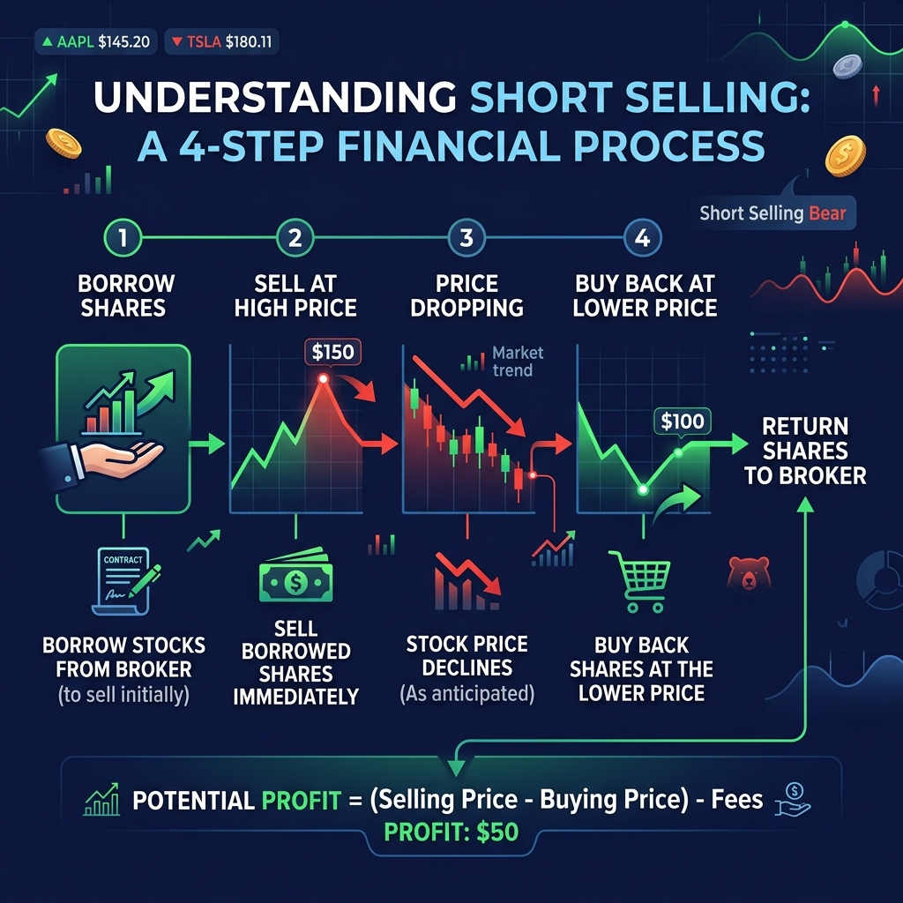

# Bán khống là gì? Cơ chế giao dịch và quy định tại Việt Nam

Phần lớn nhà đầu tư trên thị trường chứng khoán quen thuộc với chiến lược mua cổ phiếu ở vùng giá thấp và chờ bán ra khi giá tăng. Tuy nhiên, thị trường vẫn tồn tại một nghiệp vụ giao dịch đi ngược chiều: kiếm lợi nhuận khi giá tài sản sụt giảm.

Nghiệp vụ này gọi là bán khống. Bài viết này từ HVS sẽ phân tích bản chất của vị thế bán, mô tả quy trình 4 bước thực hiện, làm rõ thực trạng pháp lý tại Việt Nam và chỉ ra các phương pháp quản trị rủi ro bắt buộc cho nhà đầu tư.

## Bán khống là gì? Bản chất của vị thế bán

Bán khống (short selling) là nghiệp vụ giao dịch trong đó nhà đầu tư bán ra một loại chứng khoán mà bản thân không sở hữu tại thời điểm đặt lệnh. Số chứng khoán này được vay từ công ty chứng khoán hoặc bên cho vay, đi kèm cam kết sẽ mua lại để hoàn trả đúng số lượng trong một khoảng thời gian xác định.

Điểm khác biệt cốt lõi của vị thế bán nằm ở kỳ vọng của nhà đầu tư. Người mở vị thế tin rằng giá trị cổ phiếu sẽ giảm trong tương lai. Nếu thị trường diễn biến đúng dự báo, nhà đầu tư mua lại cổ phiếu với mức giá thấp hơn giá đã bán để trả nợ vay và hưởng phần chênh lệch giá.

Giao dịch thông thường vận hành theo quy tắc mua thấp bán cao. Trong khi đó, nghiệp vụ bán khống đảo ngược quy trình thành bán ở giá cao và mua lại ở giá thấp.

| Tiêu chí | Mua thông thường (Long Position) | Bán khống (Short Position) |
| :--- | :--- | :--- |
| **Sở hữu tài sản** | Sở hữu trực tiếp bằng vốn tự có hoặc vốn ký quỹ | Vay tài sản từ bên thứ ba để bán |
| **Kỳ vọng giá** | Thị trường tăng giá (Bullish) | Thị trường giảm giá (Bearish) |
| **Thứ tự giao dịch** | Mua trước, bán sau | Bán trước, mua lại sau |
| **Lợi nhuận tối đa** | Không có giới hạn trên (giá cổ phiếu có thể tăng mạnh) | Giới hạn ở mức 100% (khi giá cổ phiếu giảm về 0) |
| **Rủi ro lỗ tối đa** | Giới hạn ở 100% số vốn đầu tư ban đầu | Không có giới hạn trên (giá cổ phiếu tăng không trần) |

Khác với mua khống (margin long) là việc vay tiền để mua thêm cổ phiếu với kỳ vọng giá tăng, bán khống là việc vay tài sản để bán ra. Cả hai công cụ đều sử dụng đòn bẩy tài chính. Tuy nhiên, vị thế bán chịu mức độ rủi ro bất đối xứng lớn hơn do giá cổ phiếu không có mức trần chặn trên.

## Quy trình 4 bước thực hiện một giao dịch bán khống

Một giao dịch bán khống tiêu chuẩn trên thị trường quốc tế trải qua 4 bước vận hành liên tục. Nhà đầu tư cần nắm rõ từng mốc thao tác để kiểm soát chi phí nợ vay.

*Mô hình 4 bước vận hành của một giao dịch bán khống tiêu chuẩn.*

1. **Vay chứng khoán và nộp ký quỹ:** Nhà đầu tư ký hợp đồng vay cổ phiếu với công ty chứng khoán. Bạn phải thế chấp một lượng tiền mặt hoặc tài sản đảm bảo theo tỷ lệ ký quỹ ban đầu quy định.
2. **Bán chứng khoán ra thị trường:** Số cổ phiếu vừa vay được bán ngay lập tức trên sàn giao dịch theo mức giá khớp lệnh hiện hành. Số tiền thu về được phong tỏa trên tài khoản ký quỹ.
3. **Mua lại cổ phiếu để đóng vị thế:** Khi giá cổ phiếu giảm xuống vùng mục tiêu, nhà đầu tư đặt lệnh mua lại đúng số lượng cổ phiếu đã bán trước đó. Thao tác này gọi là đóng vị thế bán (short covering).
4. **Hoàn trả tài sản và quyết toán:** Số cổ phiếu vừa mua được chuyển trả lại cho bên cho vay. Hợp đồng chấm dứt sau khi quyết toán phí dịch vụ, lãi vay và các nghĩa vụ phát sinh.

Công thức tính kết quả giao dịch bán khống được xác định như sau:

> **Lợi nhuận = (Giá bán ban đầu - Giá mua lại) x Số lượng cổ phiếu - (Phí vay + Phí giao dịch + Thuế)**

Xét ví dụ cụ thể: Nhà đầu tư thực hiện vay 1.000 cổ phiếu HPG và bán ra trên sàn giao dịch HOSE ở mức giá 30.000 đồng/cổ phiếu. Tổng giá trị thu về là 30 triệu đồng.

| Kịch bản diễn biến giá | Giá mua lại cổ phiếu | Chi phí mua đóng vị thế | Kết quả giao dịch (chưa trừ phí vay) |
| :--- | :--- | :--- | :--- |
| **HPG giảm 20%** | 24.000 đồng | 24 triệu đồng | **Lãi 6 triệu đồng** |
| **HPG tăng 20%** | 36.000 đồng | 36 triệu đồng | **Lỗ 6 triệu đồng** |
| **HPG tăng 100%** | 60.000 đồng | 60 triệu đồng | **Lỗ 30 triệu đồng** |

Bảng số liệu trên thể hiện tính chất bất đối xứng về rủi ro. Khoản lãi của nhà đầu tư bị giới hạn tối đa ở mức 30 triệu đồng nếu doanh nghiệp phá sản và giá cổ phiếu về 0. Ngược lại, nếu mã cổ phiếu tăng giá gấp hai hoặc gấp ba lần, khoản lỗ sẽ vượt xa giá trị vốn ban đầu.

## Mục đích và vai trò của bán khống trên thị trường tài chính

Dù tiềm ẩn nhiều rủi ro, bán khống vẫn là công cụ không thể thiếu tại các thị trường phát triển. Hai động cơ chính thúc đẩy nhà đầu tư thực hiện nghiệp vụ này bao gồm đầu cơ và phòng thủ.

### Đầu cơ sinh lời trong xu hướng thị trường đi xuống

Trong giai đoạn thị trường gấu (bear market), giá của phần lớn cổ phiếu đều giảm điểm. Nếu chỉ sử dụng phương thức mua truyền thống, nhà đầu tư buộc phải đứng ngoài quan sát hoặc chịu thua lỗ danh mục.

Vị thế bán cung cấp công cụ tạo ra lợi nhuận ngay cả khi chỉ số chung sụt giảm. Khi phát hiện một doanh nghiệp có định giá quá cao so với giá trị thực hoặc gặp rủi ro suy giảm hoạt động kinh doanh, nhà đầu tư chuyên nghiệp sẽ mở vị thế bán để tìm kiếm lợi nhuận từ nhịp điều chỉnh.

### Phòng ngừa rủi ro cho danh mục cổ phiếu nắm giữ

Nghiệp vụ bán khống đóng vai trò là công cụ bảo hiểm tài sản (hedging) cho các quỹ đầu tư và nhà đầu tư cá nhân nắm giữ danh mục dài hạn.

Giả sử nhà đầu tư đang sở hữu danh mục cổ phiếu nhóm ngân hàng như VCB, TCB trị giá 1 tỷ đồng. Khi nhận thấy yếu tố vĩ mô ngắn hạn có nguy cơ gây áp lực giảm giá nhưng không muốn bán bỏ cổ phiếu mục tiêu do chi phí thuế và vị thế đầu tư dài hạn, bạn có thể mở vị thế bán tương ứng. Khoản lãi từ vị thế bán sẽ bù đắp trực tiếp cho phần sụt giảm giá trị của danh mục cơ sở.

Ở quy mô toàn thị trường, hoạt động bán khống góp phần cân bằng thanh khoản. Công cụ này ngăn chặn các bong bóng tài chính hình thành do hiện tượng thổi giá, đẩy giá cổ phiếu về gần với giá trị nội tại.

## Quy định pháp lý về bán khống chứng khoán tại Việt Nam

Pháp luật chứng khoán Việt Nam đã xây dựng khung khổ quản lý cho vị thế bán, nhưng mức độ áp dụng thực tế có sự phân hóa rõ rệt giữa thị trường cơ sở và thị trường phái sinh.

### Thực trạng trên thị trường chứng khoán cơ sở

Căn cứ quy định tại Thông tư 120/2020/TT-BTC của Bộ Tài chính và Nghị định 155/2020/NĐ-CP của Chính phủ, cơ quan quản lý đã đưa khái niệm giao dịch bán khống có tài sản bảo đảm vào hệ thống văn bản quy phạm pháp luật.

Tuy nhiên, giao dịch bán khống cổ phiếu cơ sở hiện chưa được triển khai thực tế tại Việt Nam. Nguyên nhân chính do hạ tầng bù trừ thanh toán theo cơ chế đối tác bù trừ trung tâm (CCP) và hệ thống cho vay chứng khoán (SBL) đang trong quá trình hoàn thiện.

Bộ Tài chính và Ủy ban Chứng khoán Nhà nước đã đưa cơ chế bán khống có kiểm soát vào Đề án nâng hạng thị trường chứng khoán Việt Nam. Lộ trình triển khai dự kiến gắn liền với quá trình đáp ứng các tiêu chuẩn đánh giá từ hai tổ chức xếp hạng MSCI và FTSE Russell trong giai đoạn tới.

Mọi hình thức thỏa thuận cho vay cổ phiếu để bán khống tự phát giữa các cá nhân hoặc qua các kênh không chính thống đều vi phạm quy định pháp luật và tiềm ẩn rủi ro lừa đảo.

### Vị thế bán hợp pháp trên thị trường phái sinh

Nhà đầu tư muốn kiếm lời khi thị trường giảm hiện có thể tham gia hợp pháp thông qua thị trường chứng khoán phái sinh.

Sản phẩm Hợp đồng tương lai chỉ số VN30 (mã VN30F1M) niêm yết trên Sở Giao dịch Chứng khoán Hà Nội (HNX) cho phép nhà đầu tư mở vị thế bán (Short) mà không cần sở hữu cổ phiếu cơ sở trước đó. Nhà đầu tư chỉ cần nộp đủ tiền ký quỹ ban đầu theo quy định của Trung tâm Lưu ký và Bù trừ Chứng khoán Việt Nam (VSDC).

Ngoài ra, sản phẩm chứng quyền có đảm bảo dạng bán (Put Warrant) do các công ty chứng khoán phát hành cũng là công cụ hợp pháp giúp nhà đầu tư bảo vệ danh mục khi giá cổ phiếu cơ sở đi xuống.

## Rủi ro lớn nhất và hiện tượng bẫy ép bán khống

Thao tác bán khống đòi hỏi kỷ luật quản trị tài khoản khắt khe hơn nhiều so với việc nắm giữ cổ phiếu thông thường.

### Rủi ro lỗ không giới hạn và chi phí lãi vay

Khác với vị thế mua chỉ lỗ tối đa bằng số tiền đầu tư khi giá cổ phiếu giảm về 0, vị thế bán có mức lỗ tăng tiến theo mức tăng giá của cổ phiếu. Nếu doanh nghiệp tăng trưởng đột biến hoặc có thông tin thâu tóm, giá cổ phiếu có thể tăng vài trăm phần trăm, khiến tài khoản bán khống bị cháy nhanh chóng.

Bên cạnh đó, việc duy trì vị thế bán phát sinh chi phí hàng ngày. Nhà đầu tư phải trả lãi vay chứng khoán cho bên cho vay, cộng thêm chi phí giao dịch và nghĩa vụ đền bù cổ tức phát sinh trong thời gian vay. Lãi vay tích lũy theo thời gian sẽ bào mòn lợi nhuận mục tiêu.

### Hiện tượng bẫy ép bán khống (Short Squeeze)

Bẫy ép bán khống là hiện tượng giá cổ phiếu đột ngột tăng mạnh, buộc những người đang mở vị thế bán phải đồng loạt mua lại cổ phiếu để đóng vị thế nhằm cắt lỗ.

Chính lực mua bắt buộc từ phe bán khống lại tiếp tục đẩy giá cổ phiếu tăng cao hơn nữa, tạo ra vòng xoáy tăng giá cưỡng bức. Những nhà đầu tư chậm chân sẽ bị ép cắt lỗ ở mức giá đỉnh.

Sự kiện kinh điển xảy ra vào năm 2008 khi tập đoàn Porsche âm thầm gom cổ phiếu Volkswagen. Thông tin này khiến số lượng cổ phiếu tự do lưu hành bị thu hẹp đột ngột. Các quỹ đầu tư đang bán khống cổ phiếu Volkswagen tranh nhau mua lại để trả nợ, đẩy giá cổ phiếu này tăng hơn 4 lần chỉ trong vài phiên giao dịch, đưa Volkswagen tạm thời trở thành công ty có giá trị lớn nhất thế giới tại thời điểm đó.

## Quản trị rủi ro khi tìm hiểu về vị thế bán cùng HVS Tài chính số

Nhiều nhà đầu tư F0 khi mới gia nhập thị trường thường nhầm lẫn giữa vị thế bán khống với việc mua đuổi margin, dẫn tới rủi ro bị gọi ký quỹ (margin call) hoặc giải chấp tài khoản ngoài dự tính. Việc thiếu kiến thức phân tích kỹ thuật để xác định điểm cắt lỗ và không nắm rõ quy trình thanh toán bù trừ là nguyên nhân chính gây thất thoát tài sản.

Để giao dịch an toàn và xây dựng tư duy quản trị rủi ro chuẩn mực, người học cần được trang bị nền tảng phân tích bài bản trước khi áp dụng các công cụ đòn bẩy trên thị trường.

Nền tảng đào tạo trực tuyến [HVS Tài chính số](https://taichinhso.hvsvn.com/thuc-tap-so) cung cấp hệ thống tri thức đầu tư chứng khoán toàn diện từ Phân tích cơ bản (FA Level 1) đến Phân tích kỹ thuật (TA Level 1). Thông qua chương trình [thực tập số](https://taichinhso.hvsvn.com/thuc-tap-so), người học được trực tiếp rèn luyện kỹ năng đọc báo cáo tài chính, xác định xu hướng thị trường và thiết lập quy tắc quản trị vốn nghiêm ngặt.

Bên cạnh đó, người học có thể trải nghiệm công cụ HVS Demo để luyện tập thao tác đặt lệnh mua bán theo dữ liệu thị trường thực tế mà không phải chịu rủi ro mất vốn. Khi gặp các vướng mắc về cơ chế giao dịch hoặc quy định ký quỹ, cộng đồng HVS Forum sẽ hỗ trợ giải đáp trực tiếp từ các nhà cố vấn giàu kinh nghiệm.

## Kết luận

Bán khống là nghiệp vụ tài chính cho phép nhà đầu tư tìm kiếm lợi nhuận trong xu hướng thị trường giảm giá thông qua cơ chế vay tài sản bán trước và mua lại sau. Tại Việt Nam, hoạt động này hiện chưa áp dụng trên thị trường cổ phiếu cơ sở nhưng được triển khai hợp pháp qua hợp đồng tương lai VN30 trên thị trường phái sinh.

Do đặc tính rủi ro lỗ không giới hạn và áp lực từ chi phí lãi vay qua đêm, việc thực hiện vị thế bán yêu cầu nhà đầu tư phải có kiến thức chuyên môn vững vàng cùng kỷ luật cắt lỗ nghiêm ngặt. Hãy tham gia ngay [HVS Tài chính số](https://taichinhso.hvsvn.com/thuc-tap-so) để làm chủ tư duy quản trị rủi ro và xây dựng chiến lược đầu tư bền vững.

**Tuyên bố miễn trừ trách nhiệm:** Thông tin trong bài viết chỉ mang tính chất giáo dục kiến thức tài chính và cập nhật quy định pháp lý, không cấu thành lời khuyên đầu tư hoặc khuyến nghị mở vị thế giao dịch. Nhà đầu tư tự chịu trách nhiệm đối với mọi quyết định tài chính của mình.

## Revision Log
- **04/09/2026 (v1.0 - Optimized):**
  - Phân tích SERP và cập nhật quy định pháp lý: Làm rõ thực trạng giao dịch bán khống theo Thông tư 120/2020/TT-BTC và Nghị định 155/2020/NĐ-CP; phân biệt rõ bán khống cơ sở (chưa triển khai) và vị thế bán hợp pháp qua Hợp đồng tương lai VN30F1M trên phái sinh HNX.
  - Bổ sung Information Gain: Thêm bảng so sánh vị thế Long vs Short, ví dụ số liệu thực tế tính toán lãi lỗ bất đối ứng với mã HPG, bổ sung Case Study Short Squeeze Porsche - Volkswagen.
  - Bảo toàn và tối ưu hình ảnh: Bổ sung 1 infographic sơ đồ 4 bước vận hành bán khống chuẩn SEO tại `content/blog/assets/co-che-ban-khong.png`.
  - Tối ưu liên kết nội bộ: Gắn các link chuẩn Sitemap tới `https://taichinhso.hvsvn.com/thuc-tap-so` cho thương hiệu HVS Tài chính số và chương trình Thực tập số.
  - Triệt tiêu AI-vibe: Xóa toàn bộ từ cấm (hành trình, mở khóa, giải pháp toàn diện, tóm lại, đáng chú ý là), không dùng ngoặc kép nhấn mạnh ở tiêu đề và nội dung, chuẩn hóa công thức dưới dạng blockquote in đậm.
